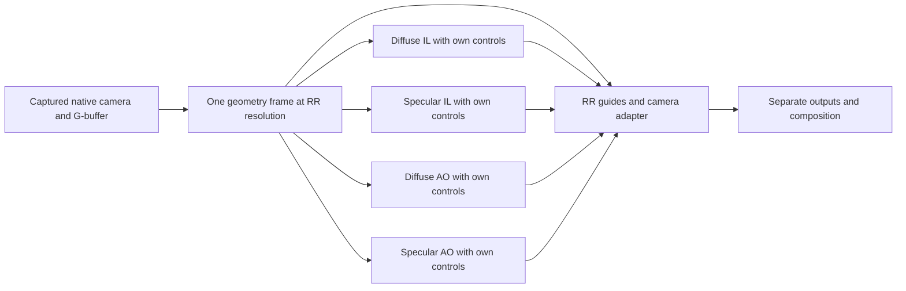

# FSR-Redstone geometry and Ray Regeneration contract

> Current source update (2026-10-28; unbuilt, untested): RedstoneGI is now a registered Feature under `src/Features/RedstoneGI/`, with assets under `features/RedstoneGI/Shaders/RedstoneGI/`. This implementation uses one native sample per RR footprint and exact matching hit surfaces, without the previous mixed-grid depth/normal/radiance mip reductions. RR Z motion is camera-expected previous depth when native XY agrees with camera motion, otherwise zero; the former historical-depth lookup is removed. This is a static-camera-transform approximation, not demonstrated animated correspondence. Four signal producers remain wired; direct-light exports, animated depth/validity transport and dominant-light blocker distance remain deferred. Historical descriptions and validation below do not validate this patch.


Analysis date: 2026-10-26. This document explains the public API and traces this checkout's producer-to-consumer transformations. It does not reverse-engineer AMD's proprietary denoising implementation or claim runtime validation of a revised integration.

## 1. Agreed boundaries

- One unified geometry foundation serves diffuse IL, specular IL, diffuse AO and specular AO.
- One logical RR resolution governs the geometry guides and all four techniques. The eventual resolution control belongs in the Ray Regeneration section; there are no per-technique resolution overrides.
- Each technique owns its enable state, sampling budget, radius and strength. Sharing geometry must not couple those controls.
- UI integration is deferred. Existing estimation equations are preserved during the structural work.
- Baseline SSGI and inactive sessions remain unaffected. Existing startup eligibility and restart behavior remain authoritative.

Only this analysis document is a deliverable of the present investigation. The implementation steps below are a usage guide, not changes already applied.

## 2. Authoritative sources and evidence limits

The AMD source reference is FidelityFX/FSR SDK 2.3.0, commit `60f4ea81909200d8542eca14dccb2628b763a9a3`, whose denoiser header declares API 1.2.0:

- [Denoiser header](https://github.com/GPUOpen-LibrariesAndSDKs/FidelityFX-SDK/blob/60f4ea81909200d8542eca14dccb2628b763a9a3/Kits/FidelityFX/denoisers/include/ffx_denoiser.h).
- [API resource and matrix types](https://github.com/GPUOpen-LibrariesAndSDKs/FidelityFX-SDK/blob/60f4ea81909200d8542eca14dccb2628b763a9a3/Kits/FidelityFX/api/include/ffx_api_types.h).
- [Technique documentation at the same commit](https://github.com/GPUOpen-LibrariesAndSDKs/FidelityFX-SDK/blob/60f4ea81909200d8542eca14dccb2628b763a9a3/Kits/FidelityFX/docs/techniques/denoising.md).
- [Sample dispatch implementation](https://github.com/GPUOpen-LibrariesAndSDKs/FidelityFX-SDK/blob/60f4ea81909200d8542eca14dccb2628b763a9a3/Samples/Denoisers/FidelityFX_Denoiser/dx12/denoiserrendermodule.cpp#L903-L941).
- [Sample signed-depth producer](https://github.com/GPUOpen-LibrariesAndSDKs/FidelityFX-SDK/blob/60f4ea81909200d8542eca14dccb2628b763a9a3/Samples/Denoisers/FidelityFX_Denoiser/dx12/shaders/denoiser_prepass.hlsl#L54-L59).
- [Sample world-normal producer](https://github.com/GPUOpen-LibrariesAndSDKs/FidelityFX-SDK/blob/60f4ea81909200d8542eca14dccb2628b763a9a3/Samples/Denoisers/FidelityFX_Denoiser/dx12/shaders/trace_rays_denoiser.hlsl#L280-L291).

The online GPUOpen manual retrieved during this investigation describes projection storage differently from the pinned header. The pinned header, pinned technique source and sample agree on row-major storage with row-vector multiplication for both matrices. Use that agreement as the versioned contract rather than combining conventions from different rendered documentation snapshots.

Evidence labels in this document:

- **Source-established:** visible in the pinned AMD sources or this checkout.
- **Derived:** follows algebraically from the stated coordinate definitions.
- **CPU-checked:** evaluated numerically using the current adapter and SimpleMath.
- **Runtime-unverified:** requires actual Skyrim camera data or provider/debug output; no such new validation was performed here.

## 3. What the current path actually supplies

Repository links below are relative to this document.

| Stage | Current source | Meaning |
| --- | --- | --- |
| Camera capture | [Globals.cpp](../../../Globals.cpp), `CacheFramebuffer` | Copies the mapped camera buffer after registered fixups, so the cache reflects the buffer supplied to shaders. |
| Matrix layouts | [Globals.h](../../../Globals.h), `FrameBuffer` and `FrameBufferCache` | Exposes current/inverse view and jittered/unjittered projection matrices plus current/previous camera-origin adjustments. |
| Shader transforms | [FrameBuffer.hlsli](../../../../package/Shaders/Common/FrameBuffer.hlsli) | Declares `row_major` matrices and uses matrix-first HLSL multiplication. |
| Estimator position | [RedstoneGI.cpp](RedstoneGI.cpp), `UpdateSB`; [common.hlsli](../../../../features/Upscaling/Shaders/Upscaling/redstone/RedstoneGI/common.hlsli) | Reconstructs position from linear depth using only projection X/Y diagonal coefficients. |
| Guide conversion | [rrPrepareInputs.cs.hlsl](../../../../features/Upscaling/Shaders/Upscaling/redstone/RedstoneGI/rrPrepareInputs.cs.hlsl) | Produces linear depth, motion, world-normal oct encoding, roughness and albedos. |
| API adapter | [RuntimeDenoiser.cpp](RuntimeDenoiser.cpp), `ToFfxMatrix` and `DispatchRayRegeneration` | Transposes cached matrices and submits current view, unjittered projection and previous-minus-current camera displacement. |
| Output consumer | [Composition.hlsli](../../../../features/Upscaling/Shaders/Upscaling/redstone/Composition.hlsli) | Reads the same world-normal guide while sampling reconstructed IL into the final render grid. |

The fact that the C++ container is `DirectX::SimpleMath::Matrix` does not establish the convention of the engine bytes copied into it. Here the shader declaration and multiplication sites establish their interpretation.

## 4. Matrix direction, storage and multiplication are separate

Use these definitions for one captured frame:

- `C`: cached `CameraView`, interpreted as the column-vector transform used by our shaders.
- `I`: cached `CameraViewInverse`; mathematically `inverse(C)`.
- `Pj`: the projection that produced the current jittered depth raster.
- `P0`: the current unjittered projection.
- `O`: `CameraPosAdjust.xyz`, the origin used to recover absolute world positions from the engine's relative positions.
- `pR`: a position in the engine's camera-relative world coordinate system.
- `pV`: a view-space position.
- `pW`: an absolute world-space position, where `pW = pR + O`.

All equations in this section use column vectors unless a row vector is explicitly shown. `T(a)` is a homogeneous translation by `a`.

The native shader route is:

```text
pV = C * [pR, 1]
pR = I * [pV, 1]
I  = inverse(C)
```

AMD's matrix field represents the equivalent row-vector route. Therefore:

```text
viewRR = transpose(C)
[pV, 1]^T = [pR, 1]^T * viewRR
inverse(viewRR) = transpose(I)
projectionRR = transpose(P0)
```

This is exactly the convention conversion performed by the current `ToFfxMatrix`. It changes the multiplication convention, not the transform direction.

**Transpose and inverse must not be interchanged.** An inverse changes world-to-view into view-to-world. A transpose adapts the same transform between these two multiplication conventions. Passing `transpose(I)` as `view` would supply the wrong direction even though its storage looks valid.

Conversely, to recover our column-vector view-to-world transform from an RR matrix:

```text
C = transpose(viewRR)
I = inverse(transpose(viewRR))
  = transpose(inverse(viewRR))
```

For a rigid camera matrix `C = [R t; 0 1]`, its inverse is `[transpose(R) -transpose(R)*t; 0 1]`. Transposing the complete affine matrix is not its inverse when translation is present.

The AMD sample copies Cauldron matrices directly because its column-major/column-vector byte layout already matches AMD's row-major/row-vector layout. Our cached matrices have a different storage interpretation, so blindly copying that sample's `memcpy` would be wrong here. The numerical check deliberately rejects that mistake with a rotated, translated camera fixture.

## 5. Points, directions and the camera-relative origin

### Positions

Our native inverse view produces `pR`. An absolute position requires the origin addition:

```text
pR = (I * float4(pV, 1)).xyz
pW = pR + O
```

This interpretation is supported by existing lighting consumers that add `CameraPosAdjust` to their engine world positions, for example [Lighting.hlsl](../../../../package/Shaders/Lighting.hlsl) when accessing landscape seams, projected world coordinates and wetness.

If an adapter explicitly chooses absolute world coordinates as its input domain, the corresponding world-to-view matrix is:

```text
Vabsolute = C * T(-O)
pV        = Vabsolute * [pW, 1]
Iabsolute = T(O) * I
viewRR_absolute = transpose(Vabsolute)
```

These equations are **derived and CPU-checked**. They are not an instruction to replace the currently submitted matrix without provider validation.

The current submission is `transpose(C)`, not `transpose(C*T(-O))`, and also submits the absolute camera-origin displacement. AMD's public header does not expose how the provider internally rebases positions or uses view translation together with that displacement. Consequently, correct storage and correct direction do not, by themselves, prove the temporal world-origin contract of our submission. Nor does source inspection prove it is broken.

The unified foundation must retain both the origin and the native relative transform explicitly. At the RR boundary, declare which world-position domain is represented and validate it with provider geometry/reprojection diagnostics. Never add an origin to a point and then treat it as still relative, or subtract that origin twice. An origin-rebase discontinuity must be handled consistently with history.

### Normals and directions

Directions use homogeneous `w = 0`:

```text
dV = (C * float4(dW, 0)).xyz
dW = (I * float4(dV, 0)).xyz
```

No `O` is added. Camera translation must not change a direction. For rigid view transforms, the inverse-view rotation also transforms normals correctly. For a general transform with nonuniform scale, normals instead require the appropriate inverse-transpose normal matrix; that is not a reason to add translation to camera normals.

The current RR guide correctly uses the inverse view's upper-left 3x3 for its decoded view-space normal. Its world axes agree with the world-normal producer demonstrated in AMD's sample. Absolute and relative world origins share those axes, so rebasing positions does not require rotating or translating normals again.

## 6. Reconstructing a position that really matches the depth pixel

The unambiguous reference is inverse projection from the matrix that generated the raster:

```hlsl
float2 uv = (float2(pixel) + 0.5) / geometrySize;
float2 ndcXY = float2(2.0 * uv.x - 1.0, 1.0 - 2.0 * uv.y);
float4 h = mul(inverseProjectionForThisDepth, float4(ndcXY, rawDepth, 1.0));
float3 pV = h.xyz / h.w;
float signedLinearDepth = pV.z;
```

This is reference pseudocode, not an installed implementation. `rawDepth` and the inverse projection must use the same standard/reversed depth convention. Converting depth to standard and then applying an already reversed inverse projection would mix conventions. Use the existing [ReverseZ helpers](../../../../package/Shaders/Common/ReverseZ.hlsli) when a conversion is actually required.

With a reduced RR grid, the geometry producer must first define which native-depth sample or footprint represents each RR pixel. It must obtain depth, normal, roughness, material and motion from compatible surfaces within that footprint. A mean depth across two unrelated surfaces is not automatically the position represented by a separately interpolated normal.

The current simplified reconstruction is:

```text
xV = (2*u - 1) * zV / Pxx
yV = (1 - 2*v) * zV / Pyy
zV = linearDepth
```

It is the centered-perspective special case. It drops off-center projection coefficients, including raster jitter offsets. Merely scaling the jitter value supplied to RR cannot restore a missing offset in the producer's reconstructed position.

A standalone shifted-projection fixture at view depth 10 produced a maximum coordinate error of `0.364713` view-space units with this diagonal-only formula, while inverse-projection reconstruction remained within `1.49422e-7`. This demonstrates the mathematical limitation, not the magnitude or visibility of an error in Skyrim's current frames.

For the unified foundation, use inverse projection as the correctness reference. An optimized linear-depth formula is acceptable only after it is derived for the actual projection coefficients and checked against that reference, including jitter and reverse depth. Preserve a distinction between the physical surface position and any local self-intersection bias used by an estimator.

## 7. Normal encoding must cross the boundary exactly once

The engine's [GBuffer helpers](../../../../package/Shaders/Common/GBuffer.hlsli) use a sign-inverted octahedral convention. `DecodeNormal` returns the engine normal by negating the standard octahedral decoding result.

The current guide path is:

```text
engine encoded normal
  -> GBuffer::DecodeNormal
  -> inverse-view rotation
  -> normalization
  -> standard octahedral encoding for RR
```

The private compositor reverses the encoding with `-GBuffer::DecodeNormal(guide.xy)`. That extra minus is necessary because the guide uses standard oct encoding, not the engine encoding. It does not reverse the physical normal.

The unified foundation should expose explicitly named view/world normals and explicit encoding boundaries. It should not reuse an ambiguously named packed normal in both spaces. Current emitter-side face-forward heuristics in `Sampling.hlsli` belong to the estimator and must not silently redefine the common surface normal or the RR guide.

The material normal and its effective roughness are also one shared guide per RR pixel. A different private roughness remapping for every signal cannot be described by different guides in the same dispatch. Current code floors both the specular estimator's roughness and RR guide roughness with the same setting. The structural work must preserve that relationship; an independent specular-AO roughness policy would require a separate explicit design decision.

## 8. Temporal routing and a single geometry grid

Keep these quantities in different domains:

| Quantity | Domain and current routing |
| --- | --- |
| Motion XY | Current-to-previous normalized image coordinates; the current adapter uses a scale of `(1,1)`. |
| Motion Z | Previous minus current signed view depth; current code samples previous depth at the reprojected UV. |
| Camera displacement | `cameraPositionDelta`: previous minus current camera-origin position, in world-axis units; not UVs and not view-axis coordinates. |
| Jitter | `jitterOffsets`: raster displacement expressed in RR-grid pixels; current code negates and scales the engine jitter to the RR extent. |
| Projection | `projection`: unjittered matrix supplied to RR; the depth reconstruction reference must separately account for the actual raster projection. |

See the [pinned motion-vector guidance](https://github.com/GPUOpen-LibrariesAndSDKs/FidelityFX-SDK/blob/60f4ea81909200d8542eca14dccb2628b763a9a3/Kits/FidelityFX/docs/techniques/denoising.md#52-providing-motion-vectors) and the local [motion producer](../../../../package/Shaders/Common/MotionBlur.hlsli).

For a stationary absolute world point, `pR_previous = pR_current + O_current - O_previous`. Our submitted camera displacement has the opposite sign, `O_previous - O_current`, as required by the API field. Do not rotate it into view space merely because the depth calculation uses view space.

The previous-depth lookup is an estimate of the previous position of the same surface. At a disocclusion it may sample another object; it is not proof of a valid correspondence. Dynamic geometry also requires correct engine motion. These are runtime validation requirements, not problems a view/inverse-view matrix alone solves.

One captured geometry frame must own matrices, origin, jitter, extent, frame identity and validity together. Current code mixes native `GetCameraData(0)` projection diagonals for estimation with the cached per-frame matrices for guides and dispatch. Those sources may agree, but one unified snapshot removes the need to assume they always do after fixups or camera changes.

## 9. Satisfying the denoiser boundary

“Fully satisfy the header” means honor every condition applicable to the selected API version and signals. It does not require enabling unrelated direct-light or debug features. The declarations alone cannot prove correct pixel meanings.

### Selected context and dispatch

| Contract item | Requirement / present evidence |
| --- | --- |
| Creation | Correct descriptor, API version, maximum grid, signal mask, checkerboard subset and DX12 backend. Current path selects indirect IL only. |
| Common dispatch | One common descriptor heads the chain. Every selected signal needs its matching descriptor, valid resources and live descriptor storage. Current paired IL chain exists. |
| Geometry | Signed view depth; compatible motion, encoded normals, roughness and material; both albedo maps where required. |
| Camera | Matching view/projection convention, jitter, camera displacement, depth bounds and frame identity. Origin semantics remain runtime-unverified. |
| Resources | Correct extents/formats/states, current data, ordered cross-API copies, output lifetime and actual consumption. |
| History | Reset after incompatible geometry/configuration changes; safe retirement before context destruction. |

This table combines the public contract with integration requirements derived from the local D3D11/D3D12 boundary. GPU ordering and signal meaning are not established by an ABI layout test.

### Signal families

| API signal | Mask bit | Structural use |
| --- | --- | --- |
| Ambient occlusion | 0 | Diffuse-AO visibility |
| Direct diffuse | 1 | Unselected |
| Direct specular | 2 | Unselected |
| Dominant light visibility | 3 | Unselected |
| Indirect diffuse | 4 | Diffuse IL |
| Indirect specular | 5 | Specular IL |
| Specular occlusion | 6 | Specular-AO visibility |

Current IL mask: `48`. Selecting all four proposed techniques for RR would produce mask `113`; this is not implemented. AO visibility must be `1` when exposed, whereas our existing buffers store occlusion coverage and clear to `0`. Conversion is therefore required before using those buffers as RR AO inputs.

Checkerboard is a packing choice inside the single RR grid: a participating signal supplies half-width packed input, while guides and output use the complete RR extent. It does not introduce another independently selectable resolution. All outputs still require composition into the game's render grid when the RR grid is reduced.

Indirect IL uses RGB plus representative hit distance. Hit-distance validity and miss handling must survive packing and fallback. Current code keeps paired IL outputs separate and does not use the output alpha as occlusion.

Configuration/query/debug declarations are conditional facilities, not mandatory extra render passes. If exposed later, their descriptor IDs, data types, element counts and creation flags must match the pinned header. No defaults should be inferred to be zero when adding configurable denoiser parameters.

### Current ABI coverage

The local [DenoiserAPI.h](DenoiserAPI.h) is a minimal compatibility declaration, not the complete official header. A standalone MSVC x64 check compared its five used descriptor structures against declarations extracted from the pinned AMD header:

| Structure | Current/reference size |
| --- | ---: |
| Context creation | 40 bytes |
| Signal | 104 bytes |
| Common dispatch | 448 bytes |
| Indirect diffuse dispatch | 120 bytes |
| Indirect specular dispatch | 120 bytes |

Sizes, alignments and all 16 common-dispatch field offsets matched. The referenced resource-description fields also match the vendored API types on source inspection. This validates the tested ABI subset, not all provider behavior or every optional ABI family.

For the four-technique boundary, use a coherent pinned official header/API set or extend the compatibility layer with equivalent checks. AO descriptors, their flags, resources, fallback and consumption are currently absent from the RR dispatch. The existing `create.flags = 0` also means exhaustive provider validation is not enabled. Provider selection/version and validation diagnostics need explicit evidence before declaring full runtime compliance.

## 10. How to use the derivation in the structural implementation

The following is the proposed organization, not new code:



The diagram describes the four-signal RR destination; current AO still bypasses RR. Merely reorganizing estimators must not silently enable that additional denoising path before it is implemented and verified.

1. Capture one native camera frame after fixups. Retain `C`, `I`, `Pj`, `P0`, their inverses where needed, `O`, previous origin, pixel jitter, native active/allocation extents, RR extent and history identity.
2. Select one RR grid. Build a coherent surface record for each grid pixel. Keep physical geometry separate from technique-specific biases.
3. Derive all view/world conversions from that captured pair. Export the matching transposed matrices at the API boundary; make the relative/absolute origin model explicit and validate it.
4. Supply shared surface inputs to four separately owned estimators. Compute sample locations from each technique's own radius. Do not use a shared maximum radius to distribute another technique's fixed budget.
5. Remove control coupling outside geometry: currently `EffectRadius = max(AORadius,GIRadius)` affects sample distribution, and `GICompensationMaxDist = AORadius` makes the AO radius affect lighting compensation. Each technique needs its own relevant parameter in the structural split, while retaining the selected weighting equations.
6. Keep one material-guide interpretation and one logical checkerboard grid. If four-signal RR is enabled, add the two AO contracts end-to-end, including inversion, history, neutral disabled output, fallback, interop and composition. Otherwise keep their current consumer path explicit.
7. Apply strength at a defined stage. IL strength is a lighting contribution; AO strength shapes visibility/attenuation. A disabled IL technique contributes zero radiance; a disabled AO technique contributes full visibility. Neither disables another producer.
8. Preserve the existing startup gate, original-SSGI boundary, and direct RR-output composition policy. UI movement is a later step.

## 11. Verification performed and required

### Performed for this document

The standalone CPU check uses the actual `ToFfxMatrix` function extracted from this checkout, DirectXTK SimpleMath and pinned reference declarations. No plugin or shader build was performed for this investigation.

| Check | Maximum absolute error / result |
| --- | ---: |
| Column-transform versus exported RR row-transform | 0 |
| View/inverse-view position round trip | `2.3293e-6` |
| Direction round trip, with translation excluded | `1.44399e-7` |
| Relative/absolute origin equation | `1.49012e-4` |
| Inverse projection, standard/reverse and shifted fixtures | `1.49422e-7` |
| Missing-transpose negative fixture | Rejected |
| Diagonal-only shifted projection | `0.364713` error, demonstrating the omitted terms |

Synthetic fixtures include identity, rotation, translation and shifted projections. Their success proves the tested equations and adapter convention, not the correctness of captured Skyrim data or AMD's internal temporal reconstruction.

### Required before calling the revised geometry/RR route runtime-compliant

- Compare captured `C*I` and `I*C` with identity; check the actual position/direction round trips under pitch, yaw, roll and translation.
- Compare inverse projection against the estimator's position at the same depth footprint, including subpixel jitter, dynamic resolution, reverse depth, edges and sky.
- Confirm world normals remain fixed for a static surface while the camera rotates; round-trip the standard oct guide through its real consumer.
- Validate the selected world-origin model using provider geometry/reprojection diagnostics. Distinguish a camera rotation from a position-origin change and an actual camera cut.
- Verify static-scene motion, depth delta and previous-surface validity under translation, disocclusion and moving objects. Do not assume a previous-depth lookup establishes correct motion for animated geometry.
- Check that all four techniques share one guide footprint and resolution while their toggles, budgets, radii and strengths remain independent.
- Verify selected signal masks/descriptors, AO polarity, checkerboard packing, history resets, fallback and actual output consumption, with provider validation enabled for diagnostic runs where supported.

Skyrim is not launched by this investigation. In-game acceptance remains with the user. The source explanation and CPU checks do not establish that the current provider submission is fully compliant; they identify what is proven and what remains to be measured.
