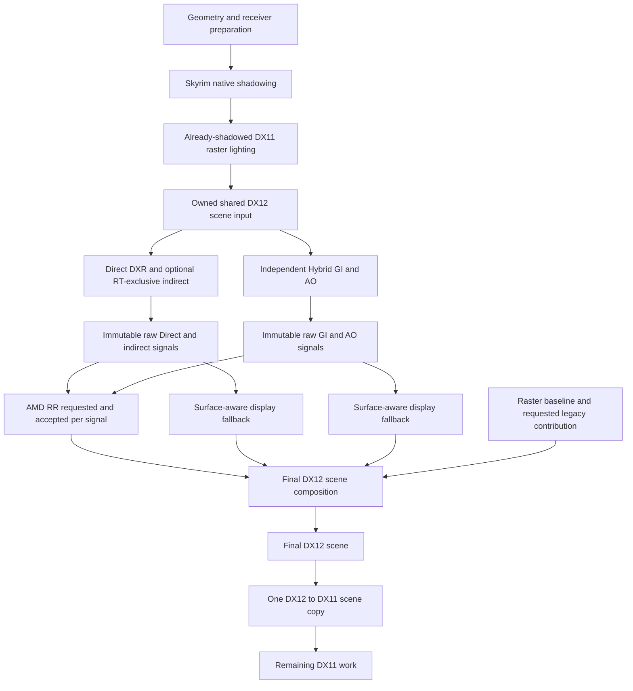

# Shared native scene pipeline

Starting revision: `fba8f697a6e290fbc523e609eaafb82ed1fc3dd6`.
Implementation: `cd0fb2c64` on `comparison/pre-rtcomposer`.

This supersedes the separate Direct/Hybrid DX11 publication described in the earlier implementation reports. The owner's shadow clarification is authoritative: **preserve existing Skyrim shadows and carry their result into DX12**. Shadow application therefore remains upstream in Skyrim's native raster lighting. No second mask multiplication is applied to the combined scene, ambient, emission or GI. This work does not introduce a replacement DXR shadow-mask producer.

## Execution and ownership



1. The generic pre-deferred-composite callback captures initially lit diffuse plus specular, after native raster shadowing and before the selected legacy GI provider's composition. The shared source belongs to DX12NativeScene, not to Hybrid. Capture records a DX11 signal and a DX12 queue wait before native producer dispatches.
2. Direct DXR uses its existing current-frame receiver, geometry, material and light snapshots. It requires the current shared scene handoff, but does not sample scene RGB to compute its PBR lighting. Its optional RT-exclusive indirect retains the existing real prepared-scene/Direct prerequisites.
3. Direct and RT-exclusive raw production, per-signal RR and display reconstruction produce separate GPU contributions. They no longer modify DX11 MAIN.
4. Hybrid reads the shared DX12 radiance resource directly. Its DX11 guide snapshot now copies only receiver guides; there is no extra radiance copy. Hybrid does not read Direct display output or accumulated GI. It then produces raw GI/AO, optional per-signal RR and display-ready contributions without modifying MAIN.
5. Final composition captures the unchanged current raster MAIN baseline, including the selected legacy provider/environment/SSS work, for fallback and independent legacy evaluation. An optional legacy connector input is sampled separately to preserve the existing Direct blend/ConnectHybrid behavior. That display input never enters native RR preparation or the native GI estimator.
6. A single DX12 pass selects the native Direct replacement/blend, adds valid RT-exclusive indirect and Hybrid contributions, performs the existing working-gamut/scene encoding, and writes the complete final scene. Invalid contribution pixels retain the raster baseline. Inactive physical borders are copied unchanged when dynamic resolution covers only part of the resource.
7. DX11 waits on final completion and copies the completed scene once into MAIN. Remaining DX11 rendering continues. The old per-producer NativePublication class and shader were removed.

The graph shows independent data dependencies. Actual submissions use the existing native queue: Direct raw/RR/display is submitted before Hybrid raw/RR/display, followed by final composition. Concurrent async-compute execution is not claimed. Neither producer consumes the other's lighting output. There is no global RR availability gate, Composer, rendering tier or producer-selection policy.

The extra raster-baseline handoff in step 5 preserves existing raster/legacy rendering; it is not fed back into the estimator. At full Direct replacement the existing Direct blend setting still selects DXR-computed lighting/visibility instead of raster Direct shading. The initially shared source and raster fallback preserve Skyrim's shadowed result unchanged.

## Signals and controls

Raw radiance, packed SDK inputs, reconstructed display contributions and the finished scene remain separate resources. Existing coordinate-based compatibility checks and [the coverage matrix](native-rr-coverage.csv) are unchanged. Display reconstruction never promotes a pixel to a traced sample. Direct SDK alpha remains 0 active/-1 inactive; indirect hit-distance/miss semantics remain unchanged. Display contribution alpha is its separate publication-validity flag, not SDK alpha. Material factors, emission and contribution strengths retain the corrected producer/display contracts.

| Owner | New independent RR selection | Bits |
|---|---|---|
| RTDirectLighting | `RRSignals`, default 3 | 0 diffuse, 1 specular |
| RTIndirectLighting | `RRSignals`, default 3 | 0 diffuse, 1 specular |
| RedstoneGI native Hybrid | `NativeRRSignals`, default 15 | 0 diffuse, 1 specular, 2 diffuse AO, 3 specular occlusion |

Family enable switches and the shared RR master switch still apply. Defaults preserve the previous selected signals. Each signal can now be unchecked independently in its owning settings. Selecting zero signals retires optional SDK work without changing producer sampling. Per-signal failures retain their corresponding raw display fallback and do not suppress other families.

The existing feature actions accept optional `rrSignals`: `setPreparedDirectLighting`, `setIndirectProducer`, and `setNativeHybrid`. Masks are bounded to the owner-supported bits. Production request-mask tests verify that a requested signal must also be genuinely produced. Sampling resolution and RR resolution stay independent.

DX12NativeScene owns `SceneCompositionBudgetMB`, default 256 MiB, configurable 64..4096 through its settings and `setNativeSceneBudget` action. This budget includes shared source textures, final scene input/output textures, optional legacy connector textures and native camera allocations. Driver-internal overhead is not measured. High resolutions or two in-flight scene slots can require a larger budget; insufficient capacity preserves working DX11 raster output and reports the reason.

## Resources and synchronization

- Two shared RGBA16F initially shadowed source slots are immutable while borrowed. Hybrid frame ownership retains the exact source resource through native completion. Source slots require both completed producer writes and no outstanding borrowing before reuse.
- Direct and Hybrid keep their existing two frame slots. Successful output offers remain pending until the final scene pass submits, then retain the final consumer fence/value. Producer completion alone cannot permit reuse while final composition still reads a contribution.
- Two final scene slots own shared input/output textures, optional legacy input, camera upload, command allocator/list, backend and retained root/pipeline/descriptor bindings. Both native completion and the DX11 return-copy retirement fence must complete before reuse.
- Slot-local descriptor ranges remain separate. Reload releases only current shader handles; submitted frames retain their bindings. Resize/allocation pressure evicts only idle, fence-complete resources. Allocation estimates use overflow-safe admission.
- Failed partially constructed/unsubmitted frames are discarded. A submitted frame whose completion cannot be signalled remains retained. Shutdown uses bounded waits and preserves in-flight ownership on timeout. No signal readback or per-frame CPU fence wait is added.
- Changing the actual graphics device/queue requires recreating the graphics session; mismatched backends are rejected instead of binding resources across devices.

Diagnostics distinguish source handoffs, source frame/provider, final composition submissions, return-copy handoffs, busy slots and unavailable reasons. Existing producer signal/context diagnostics remain separate. These are recording/ownership observations; `visualConsumptionVerified` remains false.

## Verification

- Complete universal Release `CommunityShaders` and `cpp_tests` build passed. Automatic deployment and archive generation were disabled.
- CTest `CppUtilTests`: **570 passed, one skipped; 388,092 assertions passed**. The unchanged screenshot directory-symlink case skipped for missing directory-alias privilege/support.
- Production tests cover native blending for all output-mask combinations, independent RR requests, pending-consumer reuse rejection, device-removal sentinels, and overflow-safe budget accumulation. Existing sampling/coverage tests continue to run through the CI **Run C++ unit tests** step.
- Native DXIL targets compiled, including the new `nativeSceneCompose` at cs_6_5. Modified/new DX11 guide, shared-source and legacy-input shaders compiled with FXC at cs_5_0.
- All 24 checked legacy GI/AO DXBC permutations compiled and matched the earlier baseline byte-for-byte: GI/AO x Full/Half/Quarter x adaptive on/off x reverse-Z on/off. Local evidence: `build/native-scene-legacy-verification/verification.csv`.
- Final build log: `build/native-scene-release-verification.log`; test evidence: `build/ALL/Testing/Temporary/LastTest.log`. Source whitespace checks passed.

No deployment, game launch, SDK runtime dispatch test, visual evaluation, GPU timing or performance measurement was performed. Native execution remains flat-only; existing VR paths remain available.

## Owner runtime validation

Verify each producer independently, combined requests, all producers off with RR on, every individual RR checkbox, incompatible grid fallback, sparse display coverage, Full/Half/Quarter/checkerboard Hybrid, existing shadow preservation, working-gamut/LL combinations, Direct blend and legacy connection, and absence of source feedback. Inspect the named shared input/final scene resources and actual one-copy return path. Exercise resolution changes, shader reload, scene transitions, memory pressure and both flat rendering and VR fallback. CPU predicate tests and shader compilation do not establish driver-fence correctness or visual acceptance.

## Changed files

The following source inventory is relative to the starting revision. A/D/M indicate added/deleted/modified. Pre-existing generated scene-prep files and local launchers were excluded.

```text
A	features/RTDirectLighting/Shaders/RTDirectLighting/nativeLegacyInput.cs.hlsl
A	features/RTDirectLighting/Shaders/RTDirectLighting/nativeSceneCompose.hlsl6
D	features/RTDirectLighting/Shaders/RTDirectLighting/publishNative.cs.hlsl
M	features/RedstoneGI/Shaders/RedstoneGI/nativeInputs.cs.hlsl
A	package/Shaders/Common/NativeSceneComposition.hlsli
M	package/Shaders/Common/NativeSignalSemantics.hlsli
M	src/Features/DX12NativeScene/DX12NativeScene.cpp
M	src/Features/DX12NativeScene/DX12NativeScene.h
M	src/Features/DX12NativeScene/DirectionalTrace.cpp
M	src/Features/DX12NativeScene/DirectionalTrace.h
M	src/Features/DX12NativeScene/NativeHybridDispatch.cpp
M	src/Features/DX12NativeScene/NativeHybridGI.cpp
M	src/Features/DX12NativeScene/NativeHybridGI.h
M	src/Features/DX12NativeScene/NativeHybridRR.cpp
M	src/Features/DX12NativeScene/NativeLightingRR.cpp
D	src/Features/DX12NativeScene/NativePublication.cpp
D	src/Features/DX12NativeScene/NativePublication.h
A	src/Features/DX12NativeScene/NativeSceneComposition.cpp
A	src/Features/DX12NativeScene/NativeSceneComposition.h
A	src/Features/DX12NativeScene/NativeSceneOutput.h
A	src/Features/DX12NativeScene/NativeSceneOwnership.h
A	src/Features/DX12NativeScene/NativeSceneSource.cpp
M	src/Features/DX12NativeScene/PreparedRenderer.cpp
M	src/Features/RTDirectLighting/RTDirectLighting.cpp
M	src/Features/RTDirectLighting/RTDirectLighting.h
M	src/Features/RTDirectLighting/Shaders.cmake
M	src/Features/RTIndirectLighting/RTIndirectLighting.cpp
M	src/Features/RTIndirectLighting/RTIndirectLighting.h
M	src/Features/RedstoneGI/Composition.cpp
M	src/Features/RedstoneGI/RedstoneGI.h
M	src/Features/RedstoneGI/Session.cpp
M	src/Features/RedstoneGI/Settings.cpp
A	src/Utils/RayRegenerationUI.h
M	tests/cpp/test_signal_grid.cpp
A	docs/development/native-scene-pipeline.md
M	docs/development/native-hybrid-rr.md
M	docs/development/native-renderer-corrections.md
```
